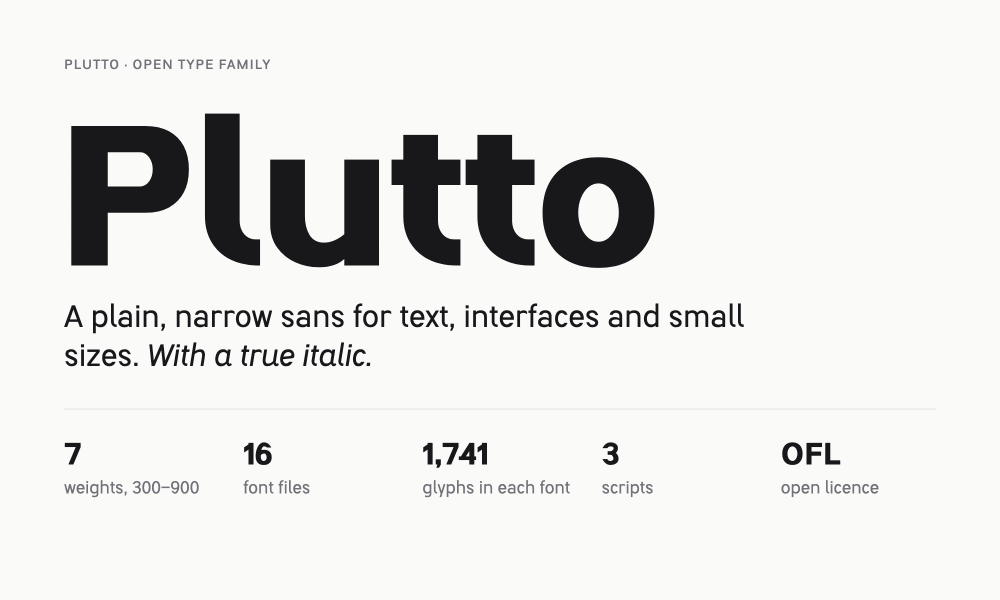
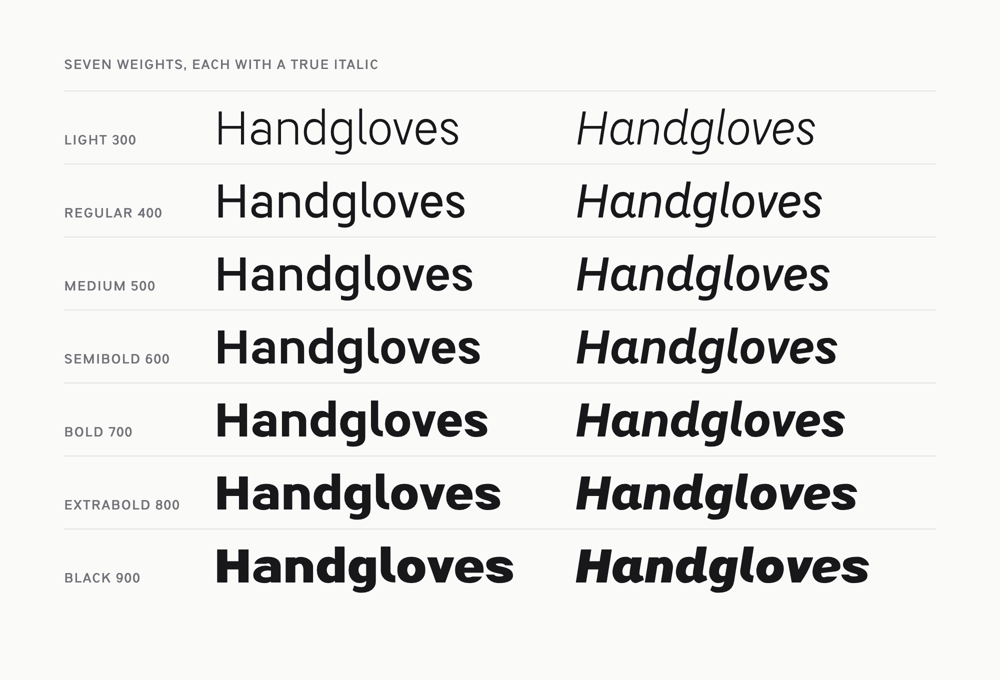
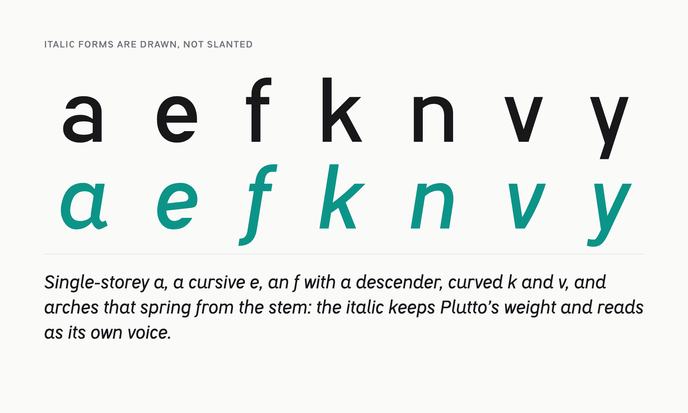
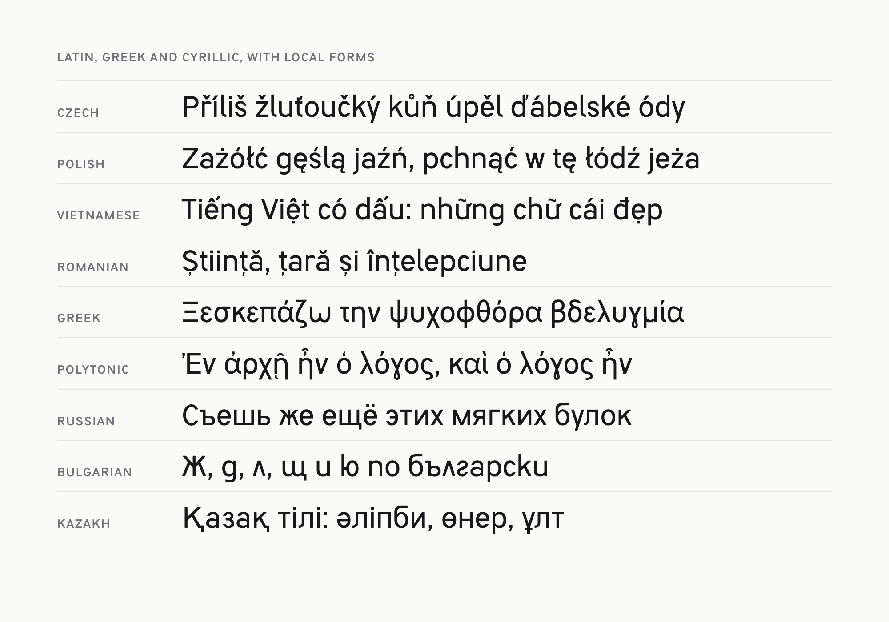
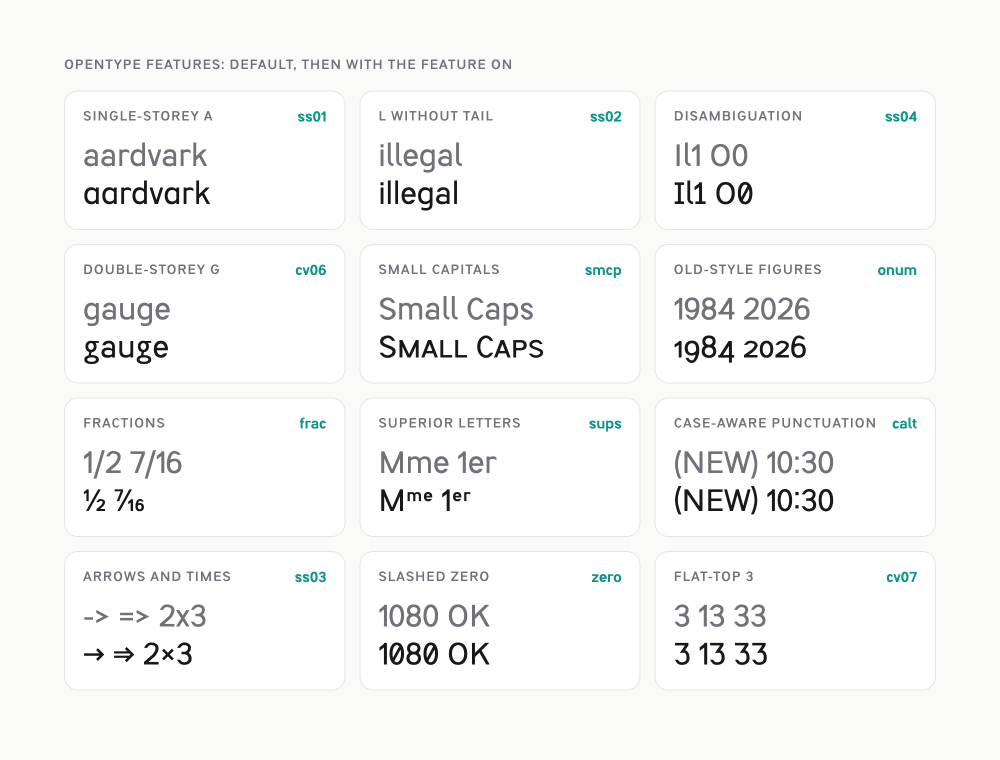
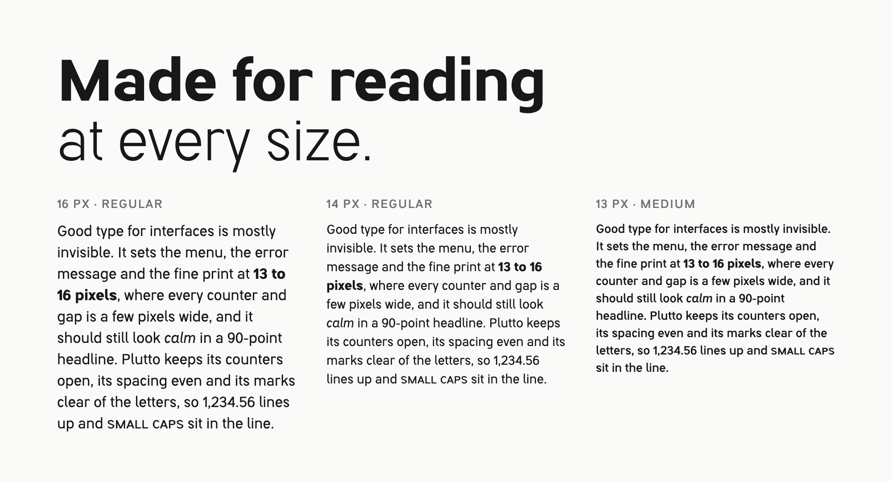

<picture>
  <source media="(prefers-color-scheme: dark)" srcset="docs/specimens/hero-dark.png">
  
</picture>

# Plutto

Created in [T3 Code](https://t3.codes).

Plutto is a plain, narrow sans for text, interfaces and small sizes. Code in [`plutto/`](plutto) draws every outline, so the whole family builds from source with one command. It has seven weights from Light to Black, a true italic for each, and variable fonts for both.

- **Weights:** Light 300, Regular 400, Medium 500, SemiBold 600, Bold 700, ExtraBold 800 and Black 900, with italics.
- **Files:** 14 static fonts and 2 variable fonts (`wght` 300–900), as TTF and WOFF2. The statics are hinted with ttfautohint.
- **Glyphs:** 1,741 in each font, for Latin, Greek and Cyrillic.
- **Metrics:** x-height 540, cap height 712, ascender 775 and descender −210 on a 1000-unit em.
- **Licence:** SIL Open Font License 1.1.

## Weights

<picture>
  <source media="(prefers-color-scheme: dark)" srcset="docs/specimens/weights-dark.png">
  
</picture>

Light, Regular, Bold and Black are drawn masters. Medium, SemiBold and ExtraBold come from the variable font at their weight, so every weight matches the variable font.

## Italic

<picture>
  <source media="(prefers-color-scheme: dark)" srcset="docs/specimens/italic-dark.png">
  
</picture>

The italic slants 9° and sets 3.5% narrower than the roman. It draws its own a, e, f, k, v, w, x, y and z, springs the n, m and h arches from the stem, and partly turns round letters instead of only slanting them. Stems, curves and joins are corrected after the slant, so the italic keeps the roman's weight.

## Languages

<picture>
  <source media="(prefers-color-scheme: dark)" srcset="docs/specimens/scripts-dark.png">
  
</picture>

- **Latin:** all of Latin-1 and Latin Extended-A, Vietnamese, pinyin, Romanian Ș Ț, the Croatian and Serbian digraphs, Irish dotted consonants, and the African and Pan-African letters (Ɛ Ɔ Ɓ Ɗ Ƙ Ƴ Ɣ Ʋ Ɖ Ǝ and others).
- **Greek:** monotonic and polytonic, with all of Greek Extended.
- **Cyrillic:** Russian, Ukrainian, Belarusian, Serbian, Macedonian, Bulgarian, Moldovan, and the Turkic, Central Asian and northern languages written in Cyrillic.
- **Local forms:** Bulgarian lowercase, Serbian and Macedonian б (and italic г д п т), Romanian comma accents, Polish kreska, Dutch í j́, Catalan punt volat, Lithuanian dotted i, Turkish i in small caps and the Sami Ŋ, all through `locl`. `ss05` and `ss06` give the Bulgarian and Serbian forms in text with no language tag.
- **Combining marks:** 22 of them, so a letter typed with marks sets the same as the precomposed one.

## Features

<picture>
  <source media="(prefers-color-scheme: dark)" srcset="docs/specimens/features-dark.png">
  
</picture>

| Feature | What it does |
| --- | --- |
| `smcp`, `c2sc` | Small capitals for every cased letter in Latin, Greek and Cyrillic, and small-cap figures |
| `tnum`, `pnum` | Tabular figures, with tabular punctuation and signs so currency and negative numbers line up |
| `onum`, `lnum` | Old-style figures, proportional or tabular |
| `frac`, `sups`, `subs` | Fractions, superscripts, superior letters a–z and subscripts |
| `calt` | Raises hyphens, colons, brackets, guillemets and @ between capitals and figures; on by default |
| `case` | Punctuation, arrows and maths signs raised for all-caps text |
| `ordn`, `zero`, `cpsp` | Ordinals and №, slashed zero, capital spacing |
| `ss01` | Single-storey a |
| `ss02` | l without the tail |
| `ss03` | `->` `=>` `<->` and `2x3` become → ⇒ ↔ and 2×3; off by default |
| `ss04` | I with serifs, 1 with a base and slashed zero, so `Il1 O0` read apart |
| `ss05`, `ss06` | Bulgarian forms; Serbian and Macedonian forms |
| `cv01`–`cv08` | 1 with a base, I with serifs, open 4, straight-tailed 6 and 9, double-storey g, flat-top 3, t without the spur |

Every stylistic set and character variant carries a name that apps show in their menus. The [technical notes](docs/technical-notes.md#features) describe each feature in full.

## In text

<picture>
  <source media="(prefers-color-scheme: dark)" srcset="docs/specimens/text-dark.png">
  
</picture>

Plutto is tuned for screens at 11 to 16 px. Counters stay open, marks keep clear of their letters, and the tests check the hinted fonts at 11 to 16 px so that no mark joins its letter and no counter fills in.

## Build

```
python3 -m plutto
```

The build needs Python 3 with fontTools, numpy, brotli and skia-pathops, plus ttfautohint on the path. It takes about four minutes and writes every font to `fonts/`; `python3 -m plutto <folder>` writes them elsewhere.

To use the web fonts:

```css
@font-face {
  font-family: "Plutto";
  src: url("Plutto-Variable.woff2") format("woff2");
  font-weight: 300 900;
  font-style: normal;
}
@font-face {
  font-family: "Plutto";
  src: url("Plutto-Italic-Variable.woff2") format("woff2");
  font-weight: 300 900;
  font-style: italic;
}
```

## Test

```
python3 -m unittest discover tests
```

The suite runs 131 tests in about eleven minutes. It builds the fonts and checks outlines, metrics, kerning, every OpenType feature, the italic, hinting at small sizes, and that every file loads. Set `PLUTTO_REQUIRE_SHAPING=1` and `PLUTTO_REQUIRE_HINTING=1` to fail the run when `hb-shape` or `ttfautohint` is missing, instead of skipping those checks.

## Specimens

The images on this page are set in the built fonts. To draw them again after a build:

```
python3 docs/specimens/render.py
```

This needs Google Chrome, and uses pngquant if it is installed.

## More

[docs/technical-notes.md](docs/technical-notes.md) explains how the outlines, italic, kerning, hinting and features are made, what the tests check, and what is not done yet.

## Licence

Copyright 2026 Pluto Labs LLC. The fonts are licensed under the SIL Open Font License 1.1 ([OFL.txt](OFL.txt)), with no reserved font name.
